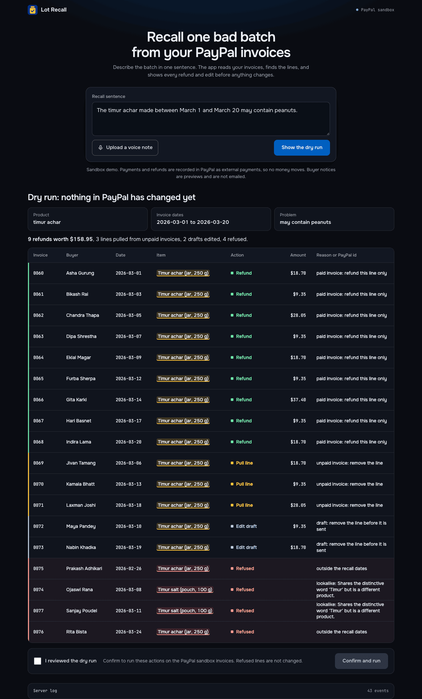
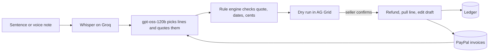

# Lot Recall

A small food seller types or says one sentence about a bad batch. Lot Recall finds the matching lines in their PayPal invoices, shows a dry run, and after they confirm it refunds or removes those lines.





## Run

```
npm install
cp .env.example .env
npm run build
npm run seed
npm start
```

Open http://localhost:3004. Without PayPal keys, the app uses a mock gateway and shows MOCK. The dry run needs `AI_API_KEY`. `npm test` runs 128 tests with no network calls.

## Limits

- PayPal sandbox only. Payments and refunds are external records, so no money moves.
- Buyer notices are previews. The app sends no email.

## Docs

- [Architecture](docs/architecture.md): flow, PayPal calls, routes, screenshots
- [Components](docs/components.md): each source file
- [Data model](docs/data-model.md): invoices, actions, rules, ledger, settings

MIT license.
