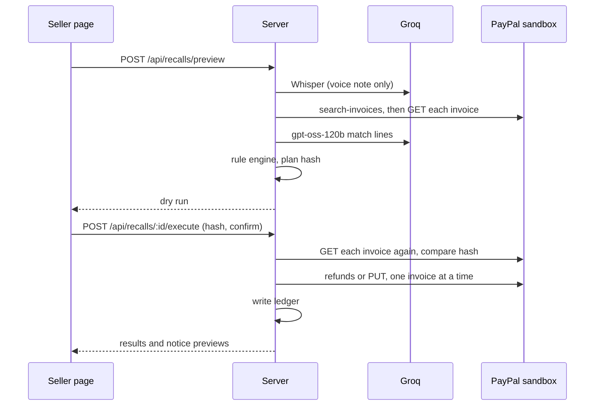
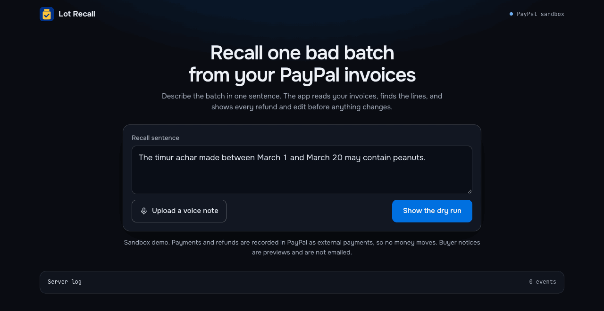
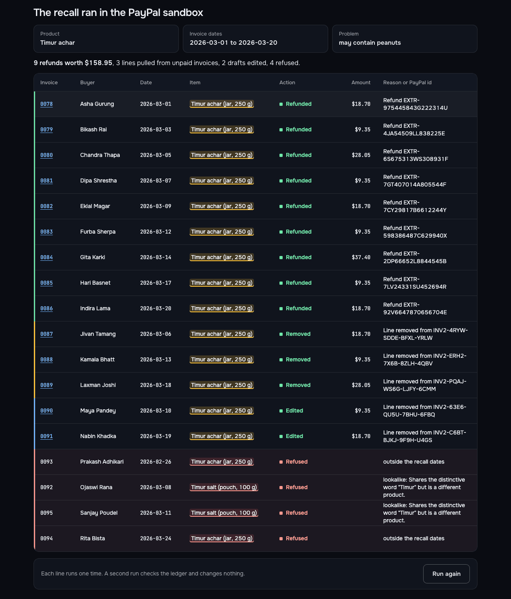
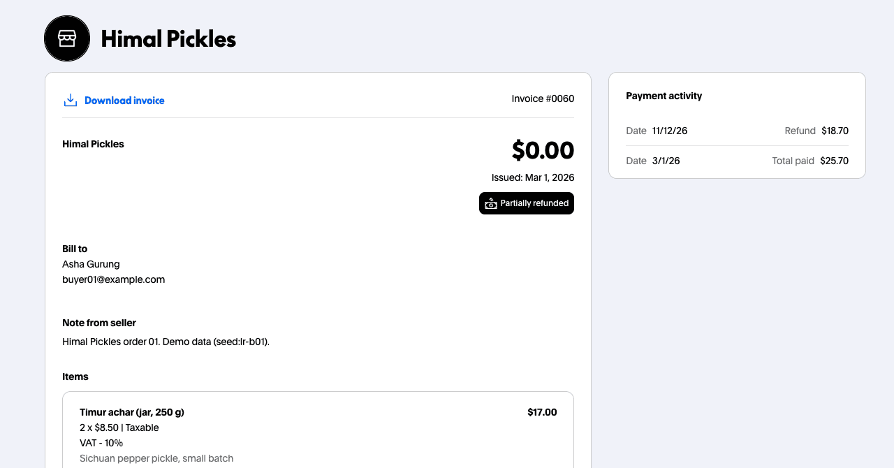

# Architecture

## Flow

1. The seller types one sentence or uploads a voice note. `whisper-large-v3-turbo` on Groq turns the voice note into text. The server gives Whisper the item names as hints.
2. The server reads the demo invoices from PayPal, with all lines.
3. `openai/gpt-oss-120b` on Groq, in JSON mode, reads the sentence and up to 80 invoice lines for each call. It returns the product, the dates, the hazard, a verdict and a quote for each line, and a notice template.
4. The rule engine checks each proposed line in code and decides the action and the amount.
5. The page shows the dry run. The seller ticks "I reviewed the dry run" and clicks "Confirm and run".
6. The server refunds paid lines, removes lines from unpaid and draft invoices, and writes each done line to the ledger.
7. A second run checks the ledger and sends no new calls.

## Screens

| Input | After the run |
| --- | --- |
|  |  |

The PayPal payer page of the first invoice after the run:

## PayPal calls

Invoicing v2 only. No Payouts and no transfer API.

| Call | Use |
| --- | --- |
| `POST /v1/oauth2/token` | Get the access token. |
| `POST /v2/invoicing/search-invoices` | Find invoices with reference `lot-recall-demo`. The result has no lines. |
| `GET /v2/invoicing/invoices/{id}` | Read each invoice with its lines, tax, payments and refunds. |
| `POST /v2/invoicing/invoices` | Seed: create an invoice with `detail.reference` and `detail.invoice_date`. |
| `POST /v2/invoicing/invoices/{id}/send` | Seed: send with `send_to_recipient: false`. |
| `POST /v2/invoicing/invoices/{id}/payments` | Seed: record an external payment. |
| `POST /v2/invoicing/invoices/{id}/refunds` | Refund the amount of one line. |
| `PUT /v2/invoicing/invoices/{id}` | Remove one line from an unpaid or draft invoice. |

## Sandbox facts that we tested

- `PUT` works on `DRAFT` and on sent `UNPAID` invoices. The body must not contain `amount`, item ids or tax amounts. Otherwise PayPal answers `400 calculation_error`. A sent invoice changes to status `SENT` after the edit.
- A partial refund changes the status to `PARTIALLY_REFUNDED`. A full refund of an external payment gives `MARKED_AS_REFUNDED`.
- PayPal created a second refund when we sent the same `PayPal-Request-Id` with a different amount. The local ledger is the guard against a second refund.

## Routes

| Route | Use |
| --- | --- |
| `GET /api/config` | Mode, model and sample sentence. |
| `POST /api/recalls/preview` | `{sentence}` or `{audioBase64, audioType}`. Returns the dry run. |
| `POST /api/recalls/:id/execute` | `{planHash, confirm: true}`. Runs the actions. |
| `GET /api/recalls/:id` | Actions with live PayPal status. |
| `GET /api/ledger` | All done actions with live invoice status. |
| `GET /api/seed-status` | Demo invoices by status. |
| `GET /api/log` | The server log. |

## Limits

- Payments and refunds are external records in the sandbox. No money moves.
- The notices are previews. The app sends no email.
- Dry runs stay in server memory. A restart forgets them. The ledger file keeps the done actions.
- The app uses the invoice date as the batch date.
- English only.
- The app does not replace the recall process of a food regulator.
